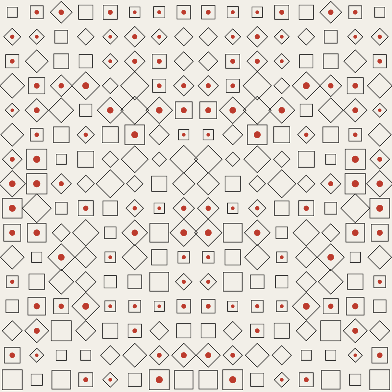

# Pattern Studies



**Generative Geometry · Python · Computational Art**

## Overview

Pattern Studies is a Python-based generative art experiment exploring repetition, symmetry, rotation, and controlled randomness.

The program uses mathematical rules to construct geometric compositions from grids of rotated squares and circular elements. Each composition is generated algorithmically rather than drawn manually.

The project explores how relatively simple computational instructions can produce complex visual structures.

## Artistic Context

Pattern Studies sits at the intersection of computational art, geometric abstraction, and textile design.

Repetition and variation are fundamental to many forms of visual composition, including weaving, quilting, and surface pattern design.

This experiment investigates how code can be used to develop visual structures that may inform future studies in textiles, printmaking, and digital art.

It is a computational study rather than a finished textile design.

## How It Works

The program:

1. Divides a square canvas into a configurable grid.
2. Places geometric elements within each grid cell.
3. Uses mirrored column positions to determine related random variations.
4. Rotates and scales squares according to a reproducible random seed.
5. Introduces occasional coloured circular elements.
6. Exports the resulting composition as an SVG vector image.

The same seed and settings produce the same composition, allowing patterns to be reproduced and compared.

## Requirements

- Python 3
- No external libraries required

## Usage

Run the program from a terminal:

```bash
python pattern_studies.py
```

This generates `pattern.svg` in the current directory.

To experiment with different settings:

```bash
python pattern_studies.py --grid 24 --seed 108 --output study_108.svg
```

### Parameters

| Parameter | Description | Default |
|---|---|---|
| `--size` | Width and height of the SVG canvas | `800` |
| `--grid` | Number of rows and columns | `16` |
| `--seed` | Random seed controlling pattern variation | `42` |
| `--output` | Name or path of the generated SVG file | `pattern.svg` |

## Output

The program generates scalable SVG artwork with a warm neutral background, dark geometric outlines, and muted red accents.

SVG files can be opened in a web browser or compatible vector graphics software.

## Possible Applications

- Computational art and geometric abstraction
- Experimental textile and quilting patterns
- Studies of repetition, variation, and symmetry
- Procedural image generation
- Exploration of rule-based visual systems

## Author

**Théophanie Parker**

Visual artist working across documentary photography, film, textiles, and digital media.

Website: https://theophanieparker.com
